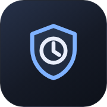

# dsh-session-autarchive



**中文** | [English](README.en.md)

把长期没动过的会话自动归档。按会话内最后一条对话结束的时间算天数，默认 5 天；已归档、置顶（可关）、标记「不自动归档」的都跳过。侧栏会话右键菜单给单个会话加标记，通用设置里改天数。

## 界面上的三处

| 位置 | 样子 | 作用 |
|---|---|---|
| 会话右键菜单 | 与「置顶会话／重命名／分叉会话／归档会话」并列的一行「不自动归档」 | 点一次标记，再点一次取消 |
| 会话行首 | 被标记的会话多一个小盾牌 | 一眼看出这条不会被自动归档 |
| 悬停卡片 | 一行「不会被自动归档」 | 同上，带文字说明 |
| 通用设置 | 最底一行「自动归档天数」 | 失焦或回车即保存，写的是宿主同一个字段 |

## 判定与执行

- **判定**：扫 `$DSH_HOME/sessions/<工作区>/session-*` 目录，解出会话档里最后一条 `turn/end`（对话结束）事件的时间当「最后活动」；超过阈值（默认 5 天）、未归档、不在保护名单、非置顶（置顶豁免默认开）的就是待归档的会话。只是被打开/恢复过不算活动——恢复会话会往档里追写开场提示，所以文件写入时间不作判据；解不出事件时退回文件最后写入时间。刚写过不到 1 小时的会话本轮跳过。
- **执行**：宿主每 10 分钟跑一轮（启动 60 秒后第一次，窗口没开也照常跑）；浏览器半边每 5 分钟拉一次待归档清单，拿到官方归档通道就当场归档，侧栏立即刷新。
- 归档走官方 `archiveSession`，不是删数据。归档后的会话在侧栏归档列表里，可以恢复。

## 安装

```sh
dsh plugin --profile desktop add github:taoziliyouchong/dsh-session-autarchive
```

装完重启 DSH。用别的 profile 就把 `desktop` 换成你的 profile 名。

兼容：DSH 0.2.2-rc.1 验证通过；更高版本未验证。

发布到 npm 之后也可以：

```sh
dsh plugin --profile desktop add dsh-session-autarchive
```

**注意：默认开启，阈值 5 天。** 装好就会开始按这个口径归档。不想让它动，先关掉：

```sh
# 工具 dsh-session-autarchive，action=config，enabled=false
```

## 工具

工具名 `dsh-session-autarchive`，五个动作：

| action | 做什么 |
|---|---|
| `status`（默认） | 配置摘要、当前待归档会话、保护名单、最近一次执行 |
| `run` | 立刻归档当前待归档会话；`dryRun: true` 只列清单不动手 |
| `protect` | 标记单个会话「不自动归档」（要 `sessionId`） |
| `unprotect` | 取消标记 |
| `config` | 改 `days`（天数）、`enabled`（开关）、`exemptPinned`（置顶是否豁免） |

## 数据文件

都在 `$DSH_HOME/session-autarchive/`：

| 文件 | 写它的地方 | 说明 |
|---|---|---|
| `protected.json` | 只有 protect／unprotect | 保护名单的唯一来源。自动归档那条定时链不碰它，怎么跑都洗不掉标记。 |
| `state.json` | 定时归档、config | 开关、阈值、置顶豁免、最近一次执行结果；不存名单。 |
| `audit.log` | 名单改动、每轮归档 | 一行一条，标记哪天没了可以对着时间查。 |

写入一律「临时文件 + 改名」，读盘失败会重试——不会把半截文件当成「没有名单」再把默认值写回去。

## 机制

- 宿主半边注册四条本机路由：`GET /dsh-session-autarchive/api/state`、`POST .../protect`、`POST .../config`、`POST .../run`。只接受回环地址（`127.*`、`::1`、`::ffff:127.*`），远程访问一律 403；方法不对 405。
- 浏览器半边用 `ctx.slots` 挂四个座位（菜单行、行首、悬停、设置行），服务探测一律 `ctx.get`，拿不到就跳过，不影响其他入口。
- 不联网、不上传任何内容；判定只用本地文件时间。

## 已知限制

- 宿主侧没有 `workspaceRegistry` 服务时，只能列出待归档会话、不能自己归档；此时由浏览器半边走官方通道执行。
- 只扫 `$DSH_HOME/sessions` 下的会话档；不在这个目录里的会话不参与判定。
- 不要与另一个自动归档插件同时安装：同一组界面座位只能挂一份，重复安装会出现两行菜单和两行设置。
- 默认开启：装好就会按 5 天阈值归档。想先观察，把 `enabled` 改成 `false`，或把 `days` 调大。

## 开发

源码分两半：

- `index.js` —— 宿主半边（判定、归档、四条路由、工具）
- `src/entry.jsx` —— 浏览器半边（菜单行、行首盾牌、悬停说明、设置行、5 分钟快通道）

改过 `src/entry.jsx` 必须重新打包。`lib/client.js` 是提交进仓库的构建产物，缺了它界面不会加载：

```sh
npm install
npm run build:client    # 重新生成 lib/client.js
npm run check:client    # 比对新产物与已提交产物是否一致
npm run smoke           # 结构 / 组合声明 / 注册 / 鉴权 / 状态读写 / 产物
npm run check           # 语法
```

冒烟全程用临时 `$DSH_HOME`，不读也不改你的会话数据。打包要求：`react` 与 `react/jsx-runtime` 保持 external（由 DSH 客户端模块表提供）；产物外壳 `window.__ModuleLoader__.load({ id, factory })` 里的 `id` 必须等于包名。

## 反馈

插件有问题，按这个顺序：

1. 开 Issue：https://github.com/taoziliyouchong/dsh-session-autarchive/issues —— 能留痕、能搜历史，别人也可能已经遇过；
2. 急着问或不想开 Issue，QQ 号：**2171960697**（加好友请注明装的是哪个插件）。

反馈时带上：DSH 版本、插件版本、报错原文、截图。少一样多半要再问一轮。

## 许可

MIT
